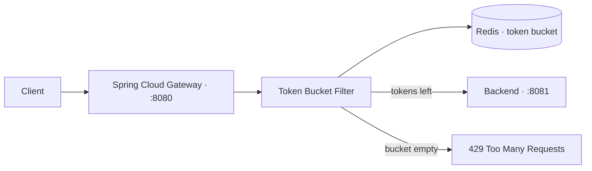
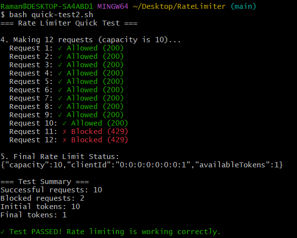

# 🚦 RateLimiter — Redis Token Bucket Gateway

   

A Redis-backed token bucket rate limiter built on Spring Cloud Gateway. It sits in front of any backend and answers `429 Too Many Requests` itself when a client goes over the limit, so the flood **never reaches your API**.

Every client gets a bucket of tokens. Each request costs one token, and the bucket refills over time. Empty bucket means wait.

## ✨ Features

- **Token bucket per client** — 10 tokens by default, refilled at 1 token/second, keyed by client IP.
- **Atomic allow/deny** — the decision comes from Redis `DECR`, so two requests racing for the last token can't both get through.
- **Zero backend changes** — point the gateway at any HTTP service; it only sees allowed traffic.
- **Route-scoped filter** — a gateway filter factory, not a global filter, so different routes can get different limits.
- **Standard headers** — every response carries `X-RateLimit-Limit` and `X-RateLimit-Remaining`; blocked responses add `Retry-After`.
- **Non-blocking** — Jedis calls run on the `boundedElastic` pool, never on the Netty event loop.
- **Self-cleaning** — bucket keys expire after 1 hour of inactivity.

## 🏗️ Architecture



The gateway owns the limit, Redis owns the state, and the backend knows nothing about rate limiting.

## 🚀 Quick Start

**Prerequisites:** Java 21 · Docker · Python 3 (for the mock backend). Maven is bundled via the wrapper.

Run each step in its own terminal.

**1. Redis** — the port must be published:

```bash
docker run -d --name redis -p 6379:6379 redis:latest   # first time
docker start redis                                      # afterwards
```

**2. Mock backend** (port 8081):

```bash
python3 mock_server.py        # Windows: py mock_server.py
```

**3. Gateway** (port 8080):

```bash
./mvnw spring-boot:run        # Windows: .\mvnw.cmd spring-boot:run
```

The gateway is ready when you see `Started RateLimiterApplication`. You can also run that class from IntelliJ.

**4. Try it:**

```bash
bash quick-test.sh
```

> If another service (e.g. Campus Hub) is already on port 8081, skip the mock server and point the gateway at it instead — see [Configuration](#️-configuration).

## ⚙️ Configuration

`src/main/resources/application.properties`:

| Property | Default | Meaning |
|---|---|---|
| `rate-limiter.capacity` | `10` | Bucket size — the burst a client can send at once |
| `rate-limiter.refill-rate` | `1` | Tokens added per second — the sustained rate after the burst |
| `rate-limiter.api-server-url` | `http://localhost:8081` | Downstream backend (use its `https` URL for a deployed one) |
| `spring.redis.host` | `localhost` | Redis host |
| `spring.redis.port` | `6379` | Redis port |

> **Note:** per-route `Config` objects exist but aren't wired to the service yet. Today every route shares the global `capacity` and `refill-rate`. See the [roadmap](#️-roadmap).

## 🔄 How a Request Is Handled

For a request to `/api/test`:

1. It arrives at the gateway on port 8080.
2. The filter picks the client ID: the first entry of `X-Forwarded-For`, otherwise the remote IP.
3. **`refillTokens`** adds `elapsed × refillRate / 1000` tokens, capped at capacity.
4. **`DECR`** atomically decrements the bucket. A result `>= 0` means allowed; a negative result means denied. No Java-side check can let a second request slip through.
5. **Allowed** → forwarded to the backend, response gets the `X-RateLimit-*` headers.
   **Denied** → the gateway returns `429` with a JSON error and `Retry-After`; the backend never sees the request.

Refill is computed from elapsed time on each request — there's no background timer. Idle clients cost nothing, and the 1-hour TTL removes buckets that never return.

## 🧩 Using It With Your Backend

Set the downstream URL — your backend needs no code changes:

```properties
rate-limiter.api-server-url=http://localhost:8081
```

**Routing.** Routes live in `GatewayConfig`. Each has a path pattern, a filter, and a downstream URL. The gateway uses the **first match**, so put specific routes first and the catch-all `/api/**` last. `stripPrefix(1)` drops the `/api` prefix, so `/api/test` reaches your backend as `/test`.

```java
.route("login-route", r -> r.path("/api/auth/login")
    .stripPrefix(1)
    .filter(tokenBucketRateLimiterFilter.apply(loginConfig))
    .uri(rateLimiterProperties.getApiServerUrl()))
.route("api-route", r -> r.path("/api/**")
    .stripPrefix(1)
    .filter(tokenBucketRateLimiterFilter.apply(new Config()))
    .uri(rateLimiterProperties.getApiServerUrl()))
```

**Choosing limits.** Capacity is the burst; refill rate is the sustained speed. Keep login strict and public reads generous. For example, login at capacity 5 / refill 2 allows 5 attempts at once, then 2 per second *(once per-route config is wired up)*.

**Handling 429s in a client.** Wait for `Retry-After` seconds before retrying, and use `X-RateLimit-Remaining` to show users how many requests they have left.

## 🔌 API

| Endpoint | Rate limited | Description |
|---|---|---|
| `ANY /api/**` | ✅ | Proxied to the downstream backend |
| `GET /gateway/health` | ❌ | `{"status":"UP","service":"Rate Limiter Gateway"}` |
| `GET /gateway/rate-limit/status` | ❌ | `{"clientId":"...","capacity":10,"availableTokens":7}` |

**Blocked response:** `429` with `{"error":"Rate limit exceeded","clientId":"..."}`, plus `Retry-After: 1` and the `X-RateLimit-*` headers.

## 🧪 Testing

```bash
bash quick-test.sh
```

The script fires 12 requests in parallel against a 10-token bucket and prints each result in request order, followed by a summary. **Expected: 10 allowed, 2 blocked.**

- Wait **10 seconds** between runs so the bucket can fully refill (1 token/second).
- The burst has to be parallel. Sequential requests rarely trigger a block because the refill keeps up.

Inspect the bucket directly in Redis:

```bash
redis-cli
KEYS "rate_limiter:*"
GET "rate_limiter:tokens:0:0:0:0:0:0:0:1"   # client ID here is IPv6 localhost (::1)
```

Keys are `rate_limiter:tokens:<clientId>` and `rate_limiter:last_refill:<clientId>`.

## 📸 Screenshots



## 🗂️ Project Structure

```
RateLimiter/
├── src/main/java/com/SD/RateLimiter/
│   ├── config/
│   │   ├── GatewayConfig.java            # routes: /api/** -> backend, stripPrefix(1)
│   │   ├── RateLimiterProperties.java    # capacity, refill-rate, api-server-url
│   │   └── RedisConfig.java              # JedisPool bean
│   ├── filters/
│   │   └── TokenBucketRateLimiterFilter.java   # the gatekeeper
│   ├── service/
│   │   ├── RateLimiterService.java       # thin pass-through layer
│   │   └── RedisTokenBucketService.java  # refill + DECR logic
│   ├── controller/
│   │   └── StatusController.java         # /gateway/health, /gateway/rate-limit/status
│   └── RateLimiterApplication.java
├── src/main/resources/
│   └── application.properties
├── mock_server.py                        # test backend on port 8081
└── quick-test.sh                         # 12-request demo: 10 allowed, 2 blocked
```

## 💡 Design Notes

**The atomic decrement decides.** Only the `DECR` result gates a request; the `GET` before it never allows anything. 12 requests against a 10-token bucket always yield exactly 10 allowed and 2 denied.

**Redis never touches the event loop.** Jedis blocks, so calls run via `Mono.fromCallable(...).subscribeOn(Schedulers.boundedElastic())`.

**The filter is route-scoped.** Each route can carry its own `Config`, so login can be strict while public routes stay generous. Route order matters.

## 🗺️ Roadmap

- [ ] **Lua script** — refill + decrement as one atomic step, closing the GET-then-SET race in the refill
- [ ] **Wire per-route `Config`** — pass each route's limits through to the service instead of the global ones
- [ ] **Unit tests** — first request allowed, 11th denied, refill after waiting
- [ ] **Dynamic `Retry-After`** — return the real seconds until the next token instead of a fixed `1`
- [ ] **Trusted proxy list** — only honor `X-Forwarded-For` from known proxies so it can't be spoofed
- [ ] **Per-user limiting** — key buckets by user ID so NAT/VPN users stop sharing one bucket
- [ ] **Lettuce migration** — replace blocking Jedis with non-blocking Lettuce and drop the `boundedElastic` workaround

---

**Thanks for checking out RateLimiter.**
